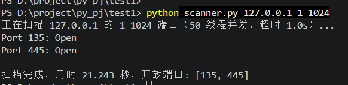

# port-scanner

一个用 Python 编写的多线程 TCP 端口扫描器，用于学习网络基础与并发编程。

> ⚠️ **仅限扫描你自己拥有或已获得明确授权的主机。** 未经授权扫描他人系统可能违法。

## 功能

- 扫描指定 IPv4 地址或主机名的端口范围
- 多线程并发扫描（默认 50 线程，可调）
- 对常见开放端口显示服务说明（如 22 SSH、445 SMB、3389 RDP）
- 单线程模式，以及单线程与并发的耗时对比（`--benchmark`）
- 输入校验：端口范围、超时、线程数，并提示暂不支持 IPv6

## 环境

Python 3，仅使用标准库，无需安装依赖。开发环境：Python 3.14.7。

## 使用方法

```bash
# 扫描本机 1-1024 端口
python scanner.py 127.0.0.1 1 1024

# 自定义超时（秒）和线程数
python scanner.py 127.0.0.1 1 1024 -t 0.5 -w 100

# 单线程与并发的耗时对比
python scanner.py 127.0.0.1 1 1024 --benchmark
```

| 参数 | 含义 | 默认值 |
|---|---|---|
| `target` | 目标 IP 或主机名 | 必填 |
| `start_port` / `end_port` | 起止端口 | 1 / 1024 |
| `-t` | 单个端口的连接超时（秒） | 1 |
| `-w` | 并发线程数 | 50 |
| `--sequential` | 只用单线程扫描 | - |
| `--benchmark` | 顺序与并发各扫一遍并对比 | - |

## 运行示例



## 性能对比

测试环境：Windows，扫描本机回环地址 127.0.0.1
扫描范围：1-1024，超时 1 秒

| 模式 | 耗时 | 开放端口 |
|---|---|---|
| 单线程 | 1030.955 秒 | 135、445 |
| 50 线程并发 | 21.250 秒 | 135、445 |

并发提速约 48.5 倍，两种模式结果一致。


## 实现要点

- 每个线程独立创建 socket，线程之间不共享连接对象
- 使用 `connect_ex` 通过返回值判断端口是否开放，并设置超时
- 并发结果按完成顺序返回，最后统一排序
- 用 `argparse` 的自定义类型检查做参数校验

## 局限

- 只支持 IPv4 和 TCP 全连接扫描，不支持 UDP 和 IPv6
- 只判断端口是否开放，不识别具体服务版本
- 常见端口说明是内置的固定列表，不是根据实际响应判断的

## 免责声明

本工具仅用于学习和授权范围内的安全测试，使用者需自行承担使用后果。